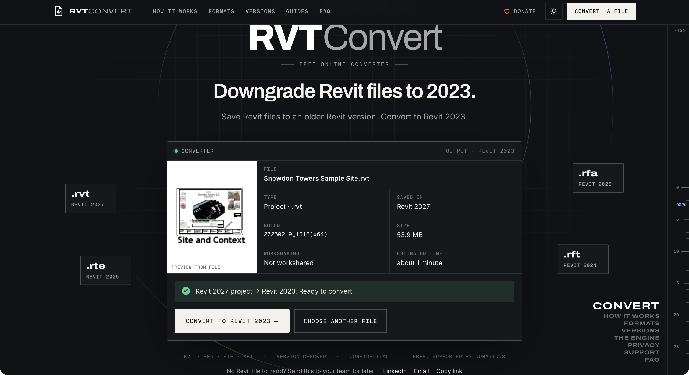
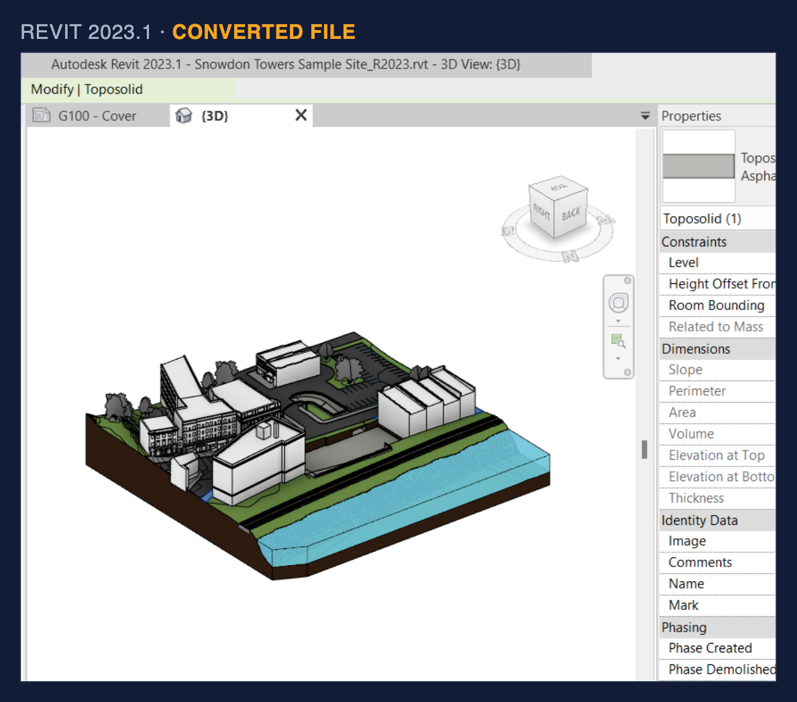
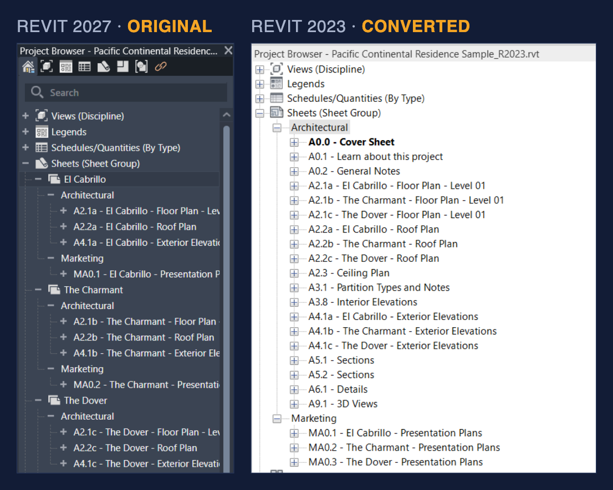
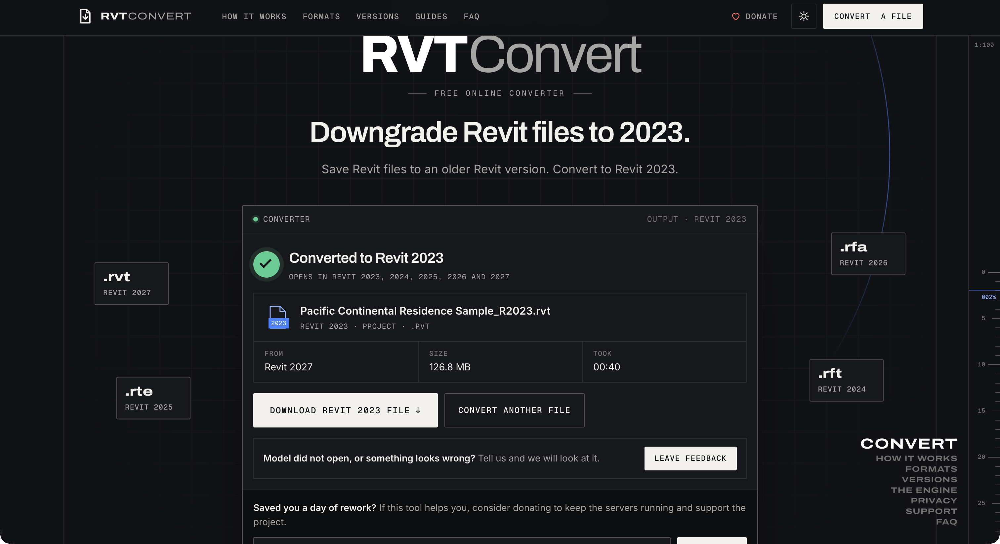
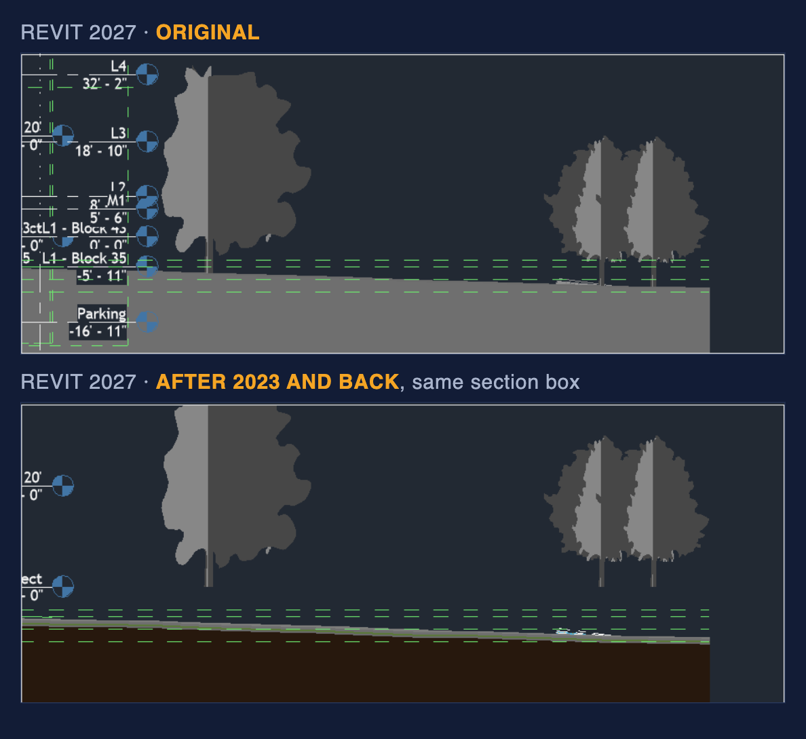
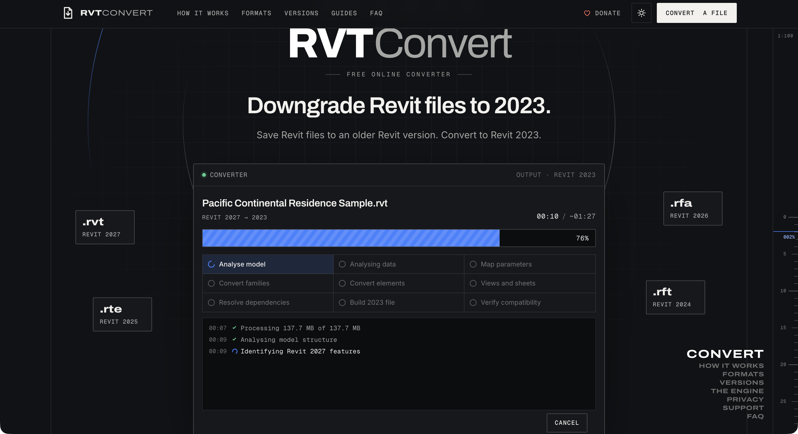

# Downgrading Revit 2027 to 2023: a measured test of RVTConvert

I tested [RVTConvert](https://rvtconvert.com/), built by Moin Nagani and team, on six Revit 2027 files with 30,584 elements in total.
In Revit 2023 the model comes back as the same model: geometry and positions are identical across all 1,452 elements with solids, and 22,245 of 22,246 filled parameter values on modeled elements match.
Features newer than 2023 (sheet collections, part of the HVAC load schedules, saved view positions, toposolid sub-divisions and contour lines) are dropped or simplified, and the service does not report this yet.
A round trip back to 2027 is covered near the end as an extra check.

## Verdict

- For families and templates, this is the cleanest result I have seen for this problem: formulas, nested families and lookup tables survive and behave the same.
- I see the same project model in 2023: matching UniqueIds and identical measured geometry support that conclusion.
- Features newer than 2023 disappear without a loss report, and terrain sub-divisions lose their relationship to the host.
- I would keep the 2023 copy out of the 2027 project of record: the round trip changes terrain volume and planting elevations.
- Until I get a per-file list of losses, I would use this for families, templates and read-only handover copies, and diff before trusting a project.
- I would upload only files I am allowed to send to the service.

## What the service promises

[RVTConvert](https://rvtconvert.com/) offers free conversion from Revit 2024/2025/2026/2027 to Revit 2023 without an account.
It accepts `.rvt`, `.rfa`, `.rte` and `.rft` files and takes donations through Stripe.
The upload box says "UP TO 2 GB"; the FAQ a week earlier said 1 GB.

The service's terms say features newer than 2023 "may be simplified or excluded" and require the user to verify the result.
The result screen says "Converted to Revit 2023" and "OPENS IN REVIT 2023, 2024, 2025, 2026 AND 2027".
Those are the service's claims; my measurements below cover these six files.

The service states that processing takes place in the UK only, and its terms cap liability at GBP 100.
Its privacy page says originals are deleted immediately after processing, results after 24 hours, and job metadata, including file names, after 30 days.
The landing page instead says uploaded and converted files are deleted after 24 hours.
The site does not yet name the company behind the service.

## Test files

I used Autodesk content shipped in the Revit 2027 Samples folder and families extracted from those projects.
I saved the extracted families as Revit 2027 files before conversion.

| Case | File | Why I chose it |
|---|---|---|
| 01 | `rac_basic_sample_family.rfa` | Simple furniture family with 4 types, a control for family conversion |
| 02 | `Tee Reducing Double Vent - PVC - Sch 40 - DWV.rfa` | Plumbing family from Snowdon Towers Sample Plumbing: 73 parameters, 50 formulas, a 5 x 11 lookup table, 4 nested families and 4 connectors |
| 03 | `Window-Double-Hung-Triple-Fixed-Triple-Elliptical-Arch-Top.rfa` | Window from Pacific Continental Residence Sample: 58 parameters, 12 formulas, 11 nested families and 2 types |
| 04 | `DefaultMetric.rte` | Revit 2027 metric project template |
| 05 | `Snowdon Towers Sample Site.rvt` | 54 MB project with toposolids and sub-divisions, features introduced after Revit 2023 |
| 06 | `Pacific Continental Residence Sample.rvt` | 138 MB sample new in 2027: 14,720 elements, 236 views, 22 sheets, 43 schedules, 382 families, 199 materials, 25 groups, design options and sheet collections |

## Method

I used Revit 2027 build 27.3.0.28 for originals and Revit 2023 build 23.1.40.56 for converted files.
The scripts run through pyRevit CLI, with Python 3 for the comparisons.

1. I dumped every original element in Revit 2027, recording UniqueId, category, family, type, level, workset, phase, design option, location and bounding box.
   I also collected solid, face and edge counts, volume, area, MEP connectors and every parameter value.
2. I recorded types, families, materials, views, sheets, schedule fields, links, groups, warnings and project parameters.
   For families, I recorded formulas, nested families, lookup tables and geometry per type.
3. I uploaded each file through the normal browser interface and native file dialog, then downloaded the converted file.
4. I opened and dumped the converted file in Revit 2023.
   I matched by UniqueId with location fallback and compared at tolerances of 1 mm and 0.1%.
5. For the version-noise control, I dumped native Revit 2023 Autodesk samples in 2023, then opened and dumped them in 2027.
   These were `rac_basic_sample_project.rvt` and `rac_basic_sample_family.rfa`.
   Differences in this control identify changes Revit itself introduces between versions.
6. For the self-diff control, I compared a 2027 dump against itself.
   All 14,720 elements matched, with zero differences in every comparison class.
7. I reopened each converted 2023 file in Revit 2027, dumped it again and compared it with its original 2027 dump.
   This round trip separates the result in 2023 from the result after regeneration in 2027.
8. I ran editing and persistence probes in 2023: move a wall, create a wall, copy an instance, write Comments, move a toposolid, save a copy, close and reopen.
   I also changed a driving family parameter and compared dependent values and volume with the same probe in 2027.

The [script reference](scripts/README.md) documents the wrappers and output formats.
The [results index](results/README.md) links the case folders and control reports.

## Results: 2027 to 2023

Each paired count below reads `2027/2023`.
The geometry and movement rows count detected changes.

| Metric | Family basic | Family lookup | Family nested | Template | Site | Residence |
|---|---|---|---|---|---|---|
| Elements in 2027 | 1,795 | 1,921 | 3,788 | 3,110 | 5,250 | 14,720 |
| Same UniqueId in 2023 | 1,754 | 1,880 | 3,747 | 2,972 | 5,110 | 14,569 |
| Geometry changed | 0 | 0 | 0 | 0 | 0 | 0 |
| Moved | 0 | 0 | 0 | 0 | 0 | 0 |
| Category changed | 0 | 0 | 0 | 0 | 8 | 1 |
| Types, 2027/2023 | 56/56 | 90/90 | 63/63 | 611/604 | 758/749 | 1,455/1,445 |
| Families, 2027/2023 | 2/2 | 4/4 | 11/11 | 85/85 | 159/159 | 382/381 |
| Views, 2027/2023 | 8/8 | 9/9 | 10/10 | 24/24 | 105/105 | 236/236 |
| Sheets, 2027/2023 | 0 | 0 | 0 | 0 | 3/3 | 22/22 |
| Schedules, 2027/2023 | 0 | 0 | 0 | 0 | 10/10 | 43/43 |
| Materials, 2027/2023 | 24/24 | 37/37 | 41/41 | 103/103 | 100/100 | 199/199 |
| Links, 2027/2023 | 0 | 0 | 0 | 0 | 16/16 | 17/17 |
| Groups, 2027/2023 | 0 | 0 | 0 | 0 | 1/1 | 25/25 |
| Warnings, 2027/2023 | 0/0 | 0/0 | 0/0 | 0/0 | 10/6 | 19/15 |

### Identity

Of 30,584 elements, 30,032 kept the same UniqueId, or 98.2%.
The control explains the internal, uncategorized element differences: opening the native 2023 family in 2027 adds 42 internal elements.
The downgraded family loses 41 and gains 1.
I treat those internal counts as version noise.

For elements with a real category, 13,696 of 13,784 kept the same UniqueId, or 99.4%.
The 88 missing categorized elements are all features newer than 2023:

| Missing feature | Count |
|---|---|
| HVAC Load Schedules | 79 |
| View Saved Positions | 6 |
| Sheet Collections | 3 |

The category changes are separate from these losses: eight site sub-divisions and one residence sub-division become Toposolid elements.

### Geometry

I found zero geometry changes in the one-way comparison.
Across 1,452 elements carrying solids, solid count, face count, volume and area stayed the same.
No elements moved in any of the six files.
These are dump measurements at the stated tolerances, not a visual comparison of rendered images.

### Parameters

I compared about 298,000 parameter values.
A parameter absent in Revit 2023 can reflect a difference in Revit's version vocabulary.
The native 2023 control shows which parameter names Revit 2027 adds on its own.

| Case | Missing parameter values explained by the control | Remaining detail |
|---|---|---|
| Family basic | 103/103 | All explained |
| Family lookup | 134/134 | All explained |
| Family nested | 1,133/1,146 | 11 Keep Ratio values, Transparent in Elevation and Transparent in 3D remain |
| Template | 136/136 | All explained |
| Residence | 3,430/5,725 | The remainder concerns energy analytical data and toposolid excavation data |

The residence energy analytical differences include 1,665 Analytical Surfaces values, 210 Analytical Spaces values and Space/Building Type Settings.
Terrain differences include Excavation Volume on Toposolid, Individual/Total Excavation Volume and Sub-divide Offset.

On modeled categories, only 43 parameter differences remain beyond version vocabulary.
These are toposolid excavation values and one roof Volume parameter.
That roof reads 13.44 CF in 2023 and 11.95 CF in 2027, while its measured solid remains identical at 0.338 m3.
After reopening in 2027, the parameter returns to 11.95 CF.
I infer that this roof difference comes from Revit 2023's calculation of the parameter.

### Toposolid

Revit 2023 opened all toposolids with the category name Toposolid and identical volume and face count.
Toposolid first shipped in Revit 2024.
The eight site sub-divisions and one residence sub-division became standalone toposolids, with changed levels.
Their category changed from Sub-divisions to Toposolid.

The Revit 2023 API has no BuiltInCategory for Toposolid.
My probe found these elements by category name.
It could write Comments and move a toposolid, and both edits persisted after saving and reopening.
The round-trip section below shows why I would still treat this terrain conversion with caution.



The selected-file screen identifies the source version before conversion.
It does not establish what terrain relationships survive in the output.

### Families

The lookup table survived in 2023 with the same dimensions: 5 rows and 11 columns.
The window flex probe changed Width from 7'-1" to 7'-9 1/2".
The same four dependent formula parameters recomputed to the same values in 2023 and 2027: Muntin Width, One Third Width, Rough Width and Sash Width.
The volume change was identical at -0.0594 m3, matching to 15 decimal places.
The families also saved and reopened in Revit 2023.

The family reports are in [case 01](results/01-family-basic/), [case 02](results/02-family-lookup-table/) and [case 03](results/03-family-nested-formulas/).

### Views and links

The view, sheet and schedule counts survived the one-way conversion.
Element content per view also matched in the probes: residence Level 01 had 8/8 elements, and WV_Site had 479/479.
I used these counts for comparison because PNG exports from Revit 2023 in a background session came out blank.
I later checked the same models in a live Revit session; the screenshots below come from there.





In 2027 the residence files its 22 sheets in three sheet collections, one per house.
In 2023 the collections are gone and the sheets fall back to Sheet Group, with all three houses in one list.

On the Site view, the linked RVT instance was not visible.
Its source, `Snowdon Towers Sample Architectural.rvt`, was still a 2027 file and was unloaded in 2023.
The service's own guide says to convert every link separately and use Reload From.
I did not convert those linked files separately in this test.

### Editing in 2023

The site probe moved a wall, created a wall, copied an instance, wrote Comments and moved a toposolid.
All those edits persisted after saving a copy, closing and reopening it.

The residence probe rolled back on design option conflicts.
The identical probe also rolled back on the original 2027 residence model.
I attribute that failure to the model's design option constraints; it does not isolate a conversion failure.
The saved probe data is in [data/probes](data/probes/).



Every result screen showed a green check and the same success message.
None listed the elements or features dropped or simplified in that file.

## Results: round trip back to 2027

I compared each 2027 original with its converted 2023 copy reopened in Revit 2027.
These results describe a different operation from opening and editing the output in 2023.

| Metric | Family basic | Family lookup | Family nested | Template | Site | Residence |
|---|---|---|---|---|---|---|
| Parameter values changed | 0 | 0 | 0 | 474 | 499 | 1,269 |
| Geometry changed | 0 | 0 | 0 | 0 | 1 | 12 |
| Moved | 0 | 0 | 0 | 0 | 6 | 0 |
| Category changed | 0 | 0 | 0 | 0 | 8 | 1 |

- All three families returned with zero parameter changes and zero geometry changes.
- The template had 474 parameter value changes, with no element or geometry changes.
- The site main toposolid volume changed from 291,519 m3 to 296,849 m3: +5,330 m3, or +1.8%.
  Its surface area changed from 51,629 m2 to 54,002 m2.
- The residence toposolid volume changed from 8,697.5 m3 to 8,797.1 m3, or +1.1%.
- Sub-divisions remained standalone toposolids; their former host was no longer cut by them.
- Six RPC trees hosted on the former sub-divisions lost their offset: Elevation from Level went from -10'-0 29/32" to 0, so their insertion point moved from about -3.07 m to 0 while the terrain under them stayed where it was. In a live section with the same box they float 1.90 to 3.07 m above the grass.
- The Architectural link came back unloaded in 2027, even with the linked file in the same folder, so it has to be reloaded by hand.



- Eleven residence walls changed edge count, with the same volume, area and face count.
  I interpret this as harmless join cleanup.
- The 3 Sheet Collections, used by 162 sheet parameter values, did not return.
  Neither did the 79 HVAC Load Schedules or 6 View Saved Positions.

The measured project geometry matched in 2023.
The terrain drift appeared when Revit 2027 reopened and regenerated the converted files.
I would not use this round trip to update a 2027 project of record.

## Product notes

I measured the browser workflow on 20 October 2026, in the evening in Europe.
The conversion durations below are the times shown by the site.

| File | Size in | Site estimate | Conversion took | Size out |
|---|---|---|---|---|
| `rac_basic_sample_family.rfa` | 408 KB | about 1 minute | 00:12 | 376 KB |
| Tee family | 536 KB | about 1 minute | 00:13 | 500 KB |
| Window family | 2.6 MB | about 1 minute | 00:14 | 2.5 MB |
| `DefaultMetric.rte` | 5.4 MB | about 1 minute | 00:16 | 4.6 MB |
| Snowdon Towers Sample Site | 53.9 MB | about 1 minute | 00:27 | 49.8 MB |
| Pacific Continental Residence Sample | 137.7 MB | about 1 minute | 00:40 | 126.8 MB |

Before conversion, the site showed the saved Revit version, build string, worksharing status and size.
All six files were reported as "Worksharing: Not workshared".
The estimate stayed at "about 1 minute" for both the 408 KB family and the 137.7 MB project.

The progress screen had an elapsed timer, ETA, percentage bar and log.
It listed nine stages: Analyse model, Analysing data, Map parameters, Convert families, Convert elements, Views and sheets, Resolve dependencies, Build 2023 file and Verify compatibility.
One capture showed 76% while the first stage was still active.



The result screen showed From, Size and Took fields alongside the download button.
Below it were a feedback button, a donation box and share prompts for email, copying a link and LinkedIn.
The feedback text was "Model did not open, or something looks wrong?".
I did not contact support.

The workflow took about three clicks per file, with no account or email required.
Upload to download for the 138 MB project took about a minute.
The lack of a per-file loss report is my main product concern.
A green check gave no indication that sheet collections or other features had disappeared.

I performed all uploads through the normal browser interface and native file dialog.

## Roadmap ideas

The core conversion already works well. These are the things I would build next if I were on the product team.

| When | Idea | Why |
|---|---|---|
| Now | Conversion report per file | what was dropped or simplified, with element ids, so a BIM manager can sign the model off |
| Now | Feature mapping notes | sub-divisions, sheet collections, toposolid contours |
| Now | Who runs it | a company page and data handling in one place |
| Next | Linked sets | a model with its links in one upload, paths kept |
| Next | Batch for content | a whole folder of families or templates |
| Next | Pick the target version | straight to 2024, 2025 or 2026 |
| Later | Offline option | an add-in or desktop app for NDA projects |
| Later | API and CDE hooks | convert from ACC or from a script |
| Later | Team plan | audit log, DPA, priority support |

Until a per-file report exists, I would use it freely for families, templates and handover copies, and diff a project before relying on it.

## Thanks

Thanks to Moin Nagani and the team behind RVT Convert for building this and keeping it free. Downgrading Revit files has been a pain for as long as Revit has existed.

## How to reproduce

The requirements are Revit 2027 and Revit 2023, pyRevit CLI, and Python 3.
The wrappers run on the Revit workstation.
I have not included the Autodesk sample files in this repository.
Get them from the Revit installation's Samples folder and extract the two complex families from the projects listed above.

Dump the original and the downloaded conversion with the wrapper:

```powershell
scripts/run_dump.ps1 -Model original.rvt -Year 2027 -OutDir out/before
scripts/run_dump.ps1 -Model converted.rvt -Year 2023 -OutDir out/after
```

Use the generated JSON files as `before.json` and `after.json` in the comparison command:

```sh
python3 scripts/diff_dumps.py before.json after.json --out results/x --label-before 2027 --label-after 2023
```

For the round trip, dump the converted file again with `-Year 2027` and compare it with the original 2027 dump.
Repeat the native 2023 control and the self-diff before interpreting missing parameters.
The [script reference](scripts/README.md) documents extraction, editing probes and view diagnostics.

## Data

[data/dumps](data/dumps/) contains compressed JSON dumps, with these prefixes:

| Prefix | Dump source |
|---|---|
| `2027__` | Original Revit 2027 file |
| `2023__` | Converted file opened in Revit 2023 |
| `rt27__` | Converted file reopened in Revit 2027 |
| `ctrl23__` | Native 2023 control dumped in Revit 2023 |
| `ctrl27__` | Native 2023 control opened and dumped in Revit 2027 |

[data/probes](data/probes/) contains JSON output from the edit, family and view probes.
[results](results/README.md) contains per-case comparisons and the native-version controls.
Each case separates `downgrade` from `roundtrip`, with Markdown reports, category summaries, CSV detail and machine-readable summaries.
`images/service/` contains the browser screenshots; `images/views/` contains original 2027 view exports.
The repository contains derived data, not the source Autodesk models.

## Limits of this test

- I tested six files.
- All source content came from Autodesk samples; I did not test a production project.
- I did not test worksharing: all six files were not workshared.
- I did not convert linked files separately.
- I did not contact support.
- PNG exports from Revit 2023 in a background session came out blank; visual checks were done afterwards in a live Revit session.
- The service may change any day; these results describe the test on 20 October 2026.
